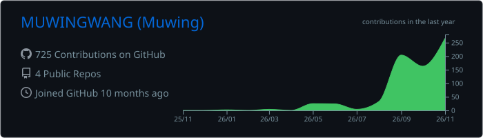
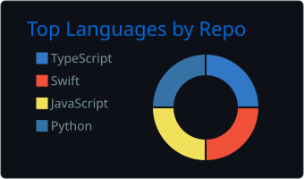
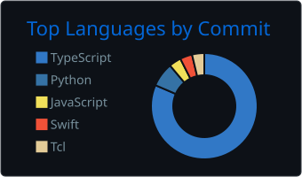
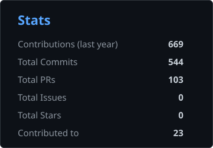
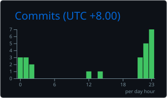

## Hi there, I'm Muwing 👋

- 🎓 Tianjin University · Electromagnetic Tomography (EMT) research
- 🤖 Building AI tools and agents for fun and for research
- 🐾 Side projects: desktop pets, workflows, and little experiments

  

  
  

  
  

<picture>
  <source media="(prefers-color-scheme: dark)" srcset="https://raw.githubusercontent.com/MUWINGWANG/MUWINGWANG/output/github-snake-dark.svg" />
  
</picture>
